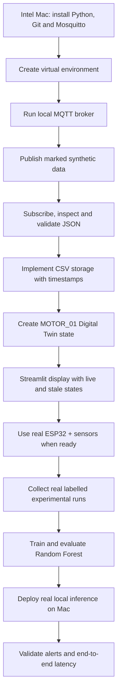
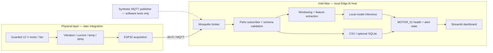
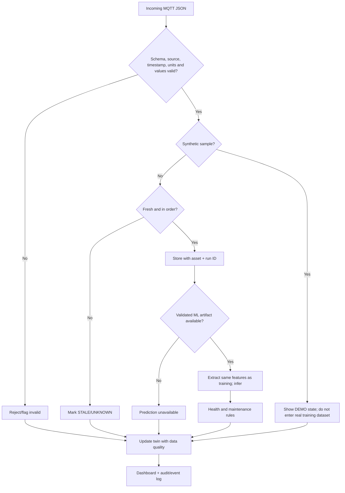
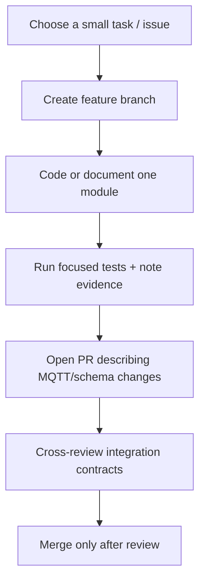

# Illustrated implementation workflows

These GitHub-rendered Mermaid diagrams represent the **intended** system and the **current software-only integration path**. They are not evidence that hardware or Edge AI has already been implemented.

## A. Software-first workflow (starting 17 October 2026)

The Mac acts as a local edge host. The physical acquisition path joins the same MQTT interface later; the Raspberry Pi is an **optional future deployment target**, not a prerequisite for software development.

## B. Data and control boundaries

**Never confuse demo data with real sensor evidence.** The mock publisher labels all packets `synthetic: true`. Physically safe motor shutdown must remain independent of MQTT, inference, and the dashboard.

## C. Data-quality and alert workflow

Do not display a fabricated HEALTHY status when the data are stale or the model is unavailable.

## D. Repeatable research and training workflow

```mermaid
flowchart LR
  RUN["Safe independent test runs"] --> LABEL["Manifest, label and run ID"]
  LABEL --> SPLIT["Split by complete runs"]
  SPLIT --> TRAIN["Fit preprocessing + Random Forest"]
  TRAIN --> TEST["Evaluate held-out runs"]
  TEST --> METRICS["Macro-F1, confusion matrix, false alarms"]
  METRICS --> EXPORT["Export model + feature contract"]
  EXPORT --> EDGE["Deploy locally on Mac; optional Pi later"]
```

Version 1 is anomaly/fault classification, **not Remaining Useful Life prediction**. The independent run split prevents adjacent vibration windows leaking into evaluation.

## E. Five-member collaboration workflow

Suggested initial handoffs: acquisition firmware; safe motor + sensors; MQTT subscriber/storage; ML/features; Digital Twin/dashboard. The existing [team responsibilities](../README.md#team-collaboration) provide ownership; share contract changes in PRs.

## F. Demo success sequence

1. Start in software-only mode; demonstrate clearly labelled simulated traffic.
2. Once physical integration exists, show **real** sensor changes during normal operation.
3. Introduce one bounded, guarded abnormal condition.
4. Show updated data, classification and `MOTOR_01` health state.
5. Confirm an alert and a later recovery to normal.
6. Record accuracy, false alarms and sensor-to-dashboard delay from actual experiments.

See [test plan](TEST_PLAN.md), [safety controls](SAFETY.md), and [Mac setup](SOFTWARE_SETUP_MAC.md).
